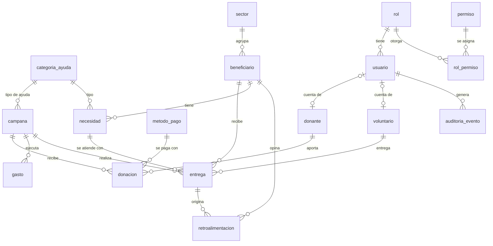

# Modelo de datos (v2)

18 tablas, 4 vistas, 53 procedimientos almacenados. Fuente: `database/*.sql`.

Colores del sistema (también usados en la interfaz, tomados del diagrama original): **donar** (verde azulado) · **campañas** (azul) · **ayudar y recibir** (naranja).

## Reglas que el motor garantiza (no solo la aplicación)
| Regla | Mecanismo |
|---|---|
| Una referencia de operación no se registra dos veces con el mismo método | índice único filtrado `ux_donacion_referencia` |
| Un hogar no recibe dos entregas el mismo día en la misma campaña | `ux_entrega_dia` (solo entregas vigentes) |
| Un hogar no tiene dos necesidades **abiertas** del mismo tipo | `ux_necesidad_abierta` |
| Una persona donante o voluntaria tiene una sola cuenta | `ux_usuario_donante`, `ux_usuario_voluntario` |
| Confirmada ⇒ fecha de confirmación; Rechazada/Anulada ⇒ motivo | `CHECK` |
| Campaña única por (nombre, año) | `UNIQUE` sobre columna calculada |
| La bitácora no se edita ni se borra | trigger `INSTEAD OF UPDATE, DELETE` |
| La aplicación no lee tablas | usuario con `GRANT EXECUTE` y `DENY SELECT/INSERT/UPDATE/DELETE` |

## Ciclos de vida (validados en los procedimientos)
- **Campaña:** Borrador → Activa ⇄ Pausada → Finalizada · cualquiera → Cancelada (con motivo). No se cierra con donaciones pendientes ni entregas programadas.
- **Donación:** Pendiente → Confirmada | Rechazada | Anulada; Confirmada → Anulada (solo si el saldo no queda por debajo de lo ya gastado).
- **Gasto:** Registrado → Aprobado | Anulado. **Aprueba una persona distinta de quien registra** y solo hasta el saldo disponible.
- **Entrega:** Programada → Entregada | No realizada | Anulada; Entregada → Anulada. Al fallar, la necesidad vinculada vuelve a la cola.
- **Necesidad:** Pendiente ⇄ En atención → Cubierta | Descartada (con motivo).
- **Mensaje:** Abierta → En revisión → Resuelta → Cerrada; plazo de atención de 7 días.

## Datos de demostración (sintéticos)
Solo en desarrollo (`seed.py`, bloque *demo*): 12 necesidades, 3 entregas programadas enlazadas, 3 donaciones por verificar, 5 gastos, 5 mensajes y 6 cuentas de ejemplo. Los CSV de `database/datos/` son **fixtures de demostración sintéticos**: no contienen identidades, importes ni fechas de transacciones personales originales. Se conservan IDs y relaciones para que las pruebas y la carga de demostración sean reproducibles. Las descripciones de campaña (el CSV no tenía) y las metas de hogares de las dos campañas en curso son de demostración.
